<!--
  Lumen: 免费 SaaS / AI 落地页模板（HTML、GSAP、Lenis、Three.js），MIT 协议。
  由独立设计与开发工作室 Vantle 制作：https://vantle.studio
-->

<a href="https://middlesugar7000.github.io/lumen-saas-landing-page-template/">
  
</a>

<p align="center">
  <a href="https://middlesugar7000.github.io/lumen-saas-landing-page-template/"></a>&nbsp;
  <a href="https://github.com/MiddleSugar7000/lumen-saas-landing-page-template/generate"></a>&nbsp;
  <a href="https://github.com/MiddleSugar7000/lumen-saas-landing-page-template/archive/refs/heads/main.zip"></a>&nbsp;
  <a href="https://github.com/MiddleSugar7000/lumen-saas-landing-page-template/stargazers"></a>
</p>

<p align="center">
  
  
  
  
  <a href="https://vantle.studio/?utm_source=github&utm_medium=badge&utm_campaign=lumen"></a>
</p>

# Lumen：带 Three.js 的免费 SaaS 落地页模板（HTML + GSAP + Lenis）

**Lumen 是一个免费、MIT 协议的落地页模板，适用于 SaaS、AI 与开发者工具类产品。** 它是一张深色、电影质感的页面，为一个虚构的 AI 推理云而作，核心是一个常驻的 Three.js 场景：一枚液态铬质感的内核与玻璃光环，随着滚动溶解为 11,000 个粒子，先是汇成地球，再化为一张 GPU 算力网。环绕它的，是 GSAP ScrollTrigger 动效、Lenis 平滑滚动、由实时小 UI 组成的 Bento 网格、控制台模拟界面、定价、FAQ 等模块。纯 HTML、CSS 和 JS：无框架、无 npm、无需构建。

你可以用它做 AI 产品、API、开发者工具、云平台、B2B SaaS、创业公司发布页或候补名单页。换掉文案，一个下午就能得到一张高质感的发布页。

> **想为自己的产品定制一个？** 本模板由 **[Vantle](https://vantle.studio/?utm_source=github&utm_medium=readme&utm_campaign=lumen)** 设计并编码，这是一家专注品牌、网站与软件的独立设计与开发工作室。我们会在一个工作日内回复。**[开始一个项目 →](https://vantle.studio/?utm_source=github&utm_medium=readme&utm_campaign=lumen#start)**

---

## 目录

- [预览](#预览)
- [特性](#特性)
- [快速开始](#快速开始)
- [自定义](#自定义)
- [页面结构](#页面结构)
- [性能](#性能)
- [技术栈](#技术栈)
- [常见问题](#常见问题)
- [许可证](#许可证)
- [需要定制落地页？](#需要定制落地页)

## 预览

<a href="https://middlesugar7000.github.io/lumen-saas-landing-page-template/">
  
</a>

## 特性



- **一个滚动驱动的 3D 场景。** 一个程序化生成的 Three.js 世界（不依赖模型文件）：液态铬内核、菲涅尔玻璃光环、铬质轨道，以及一片粒子场——在钉住的故事区里完成「光晕 → 地球 → GPU 算力网」的形变，最后在结尾 CTA 背后升起为一轮「太阳」。
- **有重量的动效。** Lenis 平滑滚动、GSAP ScrollTrigger + SplitText：标题逐词升起、宣言文字随滚动点亮、控制台模拟界面倾斜归位、卡片堆叠、数字滚动、视差位移。
- **实时小 UI。** 实时刷新的延迟折线、带流动数据包的模型路由器、逐字打字的终端、自动扩缩容柱状图、循环切换的开关、可用性圆环、支出进度条。全部用 HTML/SVG 实现，不用图片。
- **13 个区块。** 首屏、客户 Logo、宣言、3D 故事、Bento 特性、控制台、数据统计、工作原理、用户评价、带月付/年付切换的定价、FAQ、CTA、页脚。
- **大屏依然流畅。** 渲染像素预算与自动画质降级，让它在 1440p/4K 显示器和笔记本上都保持顺滑（见 [性能](#性能)）。
- **Ember Dark 设计系统。** 近黑偏蓝的表面、单一余烬色强调（`#FF6A2B`）、Geist + Instrument Serif 字体搭配、发丝级描边。
- **响应式且可访问。** 流式 `clamp()` 字号、移动端布局、键盘焦点样式，并完整支持 `prefers-reduced-motion`。
- **SEO 友好。** 语义化标题层级、meta description、Open Graph 标签与 theme-color。

## 快速开始

```bash
git clone https://github.com/MiddleSugar7000/lumen-saas-landing-page-template.git
cd lumen-saas-landing-page-template
npx serve .
```

请通过本地服务器访问，而不是直接双击 `index.html`：Three.js 场景是通过 import map 加载的 ES 模块，浏览器在 `file://` 协议下会拦截它。任何静态服务器都可以（`python -m http.server` 也行）。

**免费部署：** 推送到 GitHub 并开启 **GitHub Pages**，或者把整个文件夹拖进 Netlify、Vercel、Cloudflare Pages。

## 自定义

| 想改什么 | 改哪里 |
| --- | --- |
| 颜色、圆角、缓动 | `css/style.css` 中 `:root` 上的 CSS 变量（`--bg-0`、`--accent`、`--r-lg`…） |
| 强调色 | 修改 CSS 中的 `--accent` / `--accent-2`，以及 `js/scene.js` 顶部的 `ACCENT` |
| 字体 | `<head>` 中的 Google Fonts `<link>`（Geist、Geist Mono、Instrument Serif、Noto Sans SC） |
| 文案、定价、FAQ | `index.html` 里的纯 HTML |
| 3D 场景与运镜 | `js/scene.js`（材质、粒子形态、`frame()` 中的滚动姿态） |
| 动效与小 UI | `js/main.js`（ScrollTrigger、计数器、图表、评价数据） |
| 模板署名徽标 | `index.html` 中的 `<aside class="promo">` 区块，删除即可去掉 |

## 页面结构

1. **首屏**：液态铬内核、逐词升起的大标题、实时遥测条
2. **客户 Logo 跑马灯**，两侧带渐隐遮罩
3. **宣言**，文字随滚动渐次点亮
4. **钉住的 3D 故事**，三个阶段：接入任意模型、随处运行（地球）、在算力网上扩展
5. **Bento 特性区**，含七个实时小 UI
6. **控制台模拟界面**，倾斜归位，并带浮动通知
7. **数据统计**，巨大淡色数字上叠加滚动计数
8. **工作原理**，以堆叠卡片呈现（终端、区域地图、请求追踪）
9. **用户评价**，三列纵向跑马灯
10. **定价**，带月付 / 年付切换动画
11. **FAQ** 手风琴
12. **结尾 CTA**，内核在标题背后升起
13. **页脚**，配一枚巨大字标

## 性能

无论显示器规格如何，3D 场景每帧最多渲染约 210 万像素（≈1080p）。在开了缩放的 1440p 显示器上，原生分辨率会是 600–800 万像素。泛光效果以半分辨率运行，玻璃光环使用廉价的菲涅尔着色器而非透射通道，且当屏幕上没有任何 3D 区块时场景会暂停渲染。如果帧时间仍然过长，分辨率会逐级下调，之后关闭泛光。在 `prefers-reduced-motion` 下，相机会保持静止，所有滚动动画关闭。

## 技术栈

HTML5 · CSS（自定义属性）· JavaScript（ES 模块）· [Three.js](https://threejs.org) r170 · [GSAP 3.13](https://gsap.com) + ScrollTrigger + SplitText · [Lenis](https://lenis.darkroom.engineering) · Google Fonts。所有依赖均通过 CDN 加载。

## 常见问题

**这个 SaaS 落地页模板真的免费吗？**
是的。Lumen 以 MIT 协议发布，个人与商业项目都可使用、修改和发布。唯一的要求是保留许可证声明。

**需要 React、Next.js 或构建工具吗？**
不需要。就是纯 HTML/CSS/JS，放到任意静态托管上即可。

**它适合什么样的产品？**
AI 产品、API、开发者工具、云与基础设施平台、B2B SaaS、创业公司发布页与候补名单页。任何需要深色、技术感、高端观感的产品都合适。

**可以去掉「Free template by Vantle」徽标吗？**
可以。删除 `index.html` 中的 `<aside class="promo">` 区块即可。我们欢迎你保留回链，但这从不是必须的。

**3D 场景会拖慢访客的设备吗？**
它是按可降级来构建的：限制渲染分辨率、离开屏幕即暂停、在较弱的 GPU 上自动降低画质。

**这个模板是谁做的？**
[Vantle](https://vantle.studio/?utm_source=github&utm_medium=faq&utm_campaign=lumen)，一家打造品牌、网站与软件产品的独立设计与开发工作室。

**能为我的业务做一个定制版本吗？**
可以。发邮件到 [hello@vantle.studio](mailto:hello@vantle.studio)，或通过[项目表单](https://vantle.studio/?utm_source=github&utm_medium=faq&utm_campaign=lumen#start)告诉我们。我们会在一个工作日内回复；一张聚焦的落地页通常需要 2 到 4 周。

## 许可证

[MIT](LICENSE) © MiddleSugar7000。欢迎给个 ⭐ 或回链到 [vantle.studio](https://vantle.studio/?utm_source=github&utm_medium=license&utm_campaign=lumen)，但并不强求。

Lumen 是一个虚构公司；页面上的名称、Logo、引述与数据均为占位内容。人像照片来自 [Unsplash](https://unsplash.com)，建议替换为你自己的素材。

## 由 Vantle 打造

<a href="https://vantle.studio/?utm_source=github&utm_medium=readme&utm_campaign=lumen"></a>

<p align="center">
  <a href="https://vantle.studio/?utm_source=github&utm_medium=readme&utm_campaign=lumen#start"></a>&nbsp;
  <a href="https://vantle.studio/?utm_source=github&utm_medium=readme&utm_campaign=lumen#work"></a>&nbsp;
  <a href="mailto:hello@vantle.studio"></a>
</p>

Lumen 是一个免费模板，出自 **[Vantle](https://vantle.studio/?utm_source=github&utm_medium=readme&utm_campaign=lumen)** —— 一家独立设计与开发工作室。我们把你正在做的事，变成一个让人记住的品牌、一个看得懂的网站、一个用得上的产品。

- **品牌与视觉识别：** 定位、Logo 系统、字体、色彩以及完整设计系统
- **网页设计与 3D：** 发布页、Three.js 与 WebGL、GSAP 动效、响应式实现
- **全栈产品：** SaaS 平台、仪表盘、API、鉴权、支付与 AI 功能

一张聚焦的落地页通常需要 2 到 4 周；一个完整的 SaaS 产品需要 6 到 12 周。告诉我们你在做什么：[hello@vantle.studio](mailto:hello@vantle.studio)，或通过[项目表单](https://vantle.studio/?utm_source=github&utm_medium=readme&utm_campaign=lumen#start)，我们会在一个工作日内回复。

<a href="https://vantle.studio/?utm_source=github&utm_medium=readme&utm_campaign=lumen#work"></a>

更多免费模板：[VOLT Arc](https://github.com/MiddleSugar7000/volt-arc-landing-page-template)，一张电影质感的产品发布页。

<p align="center"><sub>关键词：免费 SaaS 落地页模板、AI 落地页模板、深色落地页模板、Three.js 落地页、WebGL 落地页、GSAP ScrollTrigger 模板、Lenis 平滑滚动、创业公司落地页、开发者工具网站模板、HTML 落地页、MIT 网站模板。</sub></p>
